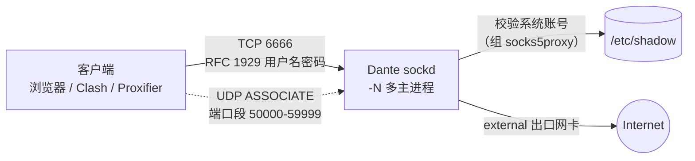
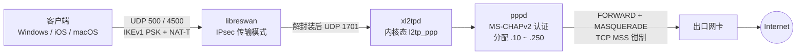

# proxy

Linux 服务端一键部署脚本：**SOCKS5 代理**（Dante）与 **L2TP/IPsec VPN**（libreswan + xl2tpd）。

两个脚本共用同一套工程骨架：自动识别发行版与出口网卡、凭据随机生成、开机自启与异常自动重启、内核网络调优（BBR / 低延迟 / UDP 游戏优化）、部署后自检、不保留服务日志，并提供 `info / status / restart / uninstall` 管理命令。

| 脚本 | 部署的服务 | 底层组件 | 认证方式 | 默认端口 |
| --- | --- | --- | --- | --- |
| [`socks5.sh`](socks5.sh) | SOCKS5 代理 | Dante `sockd` ≥ 1.4（缺包时源码编译 1.4.4） | 用户名 + 密码（RFC 1929） | TCP 6666，UDP 中继 50000-59999 |
| [`l2tp.sh`](l2tp.sh) | L2TP/IPsec VPN | libreswan ≥ 3.19 + xl2tpd（缺包时源码编译 1.3.20） | IPsec PSK + 用户名/密码（MS-CHAPv2） | UDP 500 / 4500 / 1701 |

---

## 目录

- [快速开始](#快速开始)
- [运行要求](#运行要求)
- [socks5.sh — SOCKS5 代理](#socks5sh--socks5-代理)
- [l2tp.sh — L2TP/IPsec VPN](#l2tpsh--l2tpipsec-vpn)
- [内核网络调优](#内核网络调优)
- [可靠性与安全设计](#可靠性与安全设计)
- [常见问题](#常见问题)

---

## 快速开始

建议**先下载再执行**：脚本会把自身安装为管理命令（`socks5ctl` / `l2tpctl`），通过管道执行时无法安装该命令。

```bash
# SOCKS5 代理：随机用户名/密码，端口 6666
curl -fsSL https://raw.githubusercontent.com/tmcoinup/proxy/main/socks5.sh -o socks5.sh
sudo bash socks5.sh

# L2TP/IPsec VPN：随机用户名/密码/PSK
curl -fsSL https://raw.githubusercontent.com/tmcoinup/proxy/main/l2tp.sh -o l2tp.sh
sudo bash l2tp.sh
```

指定凭据：

```bash
sudo bash socks5.sh -u alice -p 'S3cret_pw'
sudo bash l2tp.sh   -u alice -p 'S3cret_pw' -k 'MyPsk_123'
```

管道方式（不会安装管理命令）：

```bash
curl -fsSL https://raw.githubusercontent.com/tmcoinup/proxy/main/socks5.sh | sudo bash -s -- -u alice -p 'S3cret_pw'
```

国内服务器访问 `raw.githubusercontent.com` 不稳定时，改用 jsDelivr CDN 下载脚本：

```bash
curl -fsSL https://cdn.jsdelivr.net/gh/tmcoinup/proxy@main/socks5.sh -o socks5.sh
curl -fsSL https://cdn.jsdelivr.net/gh/tmcoinup/proxy@main/l2tp.sh   -o l2tp.sh
```

> jsDelivr 对分支内容有缓存，刚推送的更新可能延迟生效。

部署完成后终端会打印完整连接信息（服务器 IP、端口、凭据、代理链接等），之后可随时用 `socks5ctl info` / `l2tpctl info` 再次查看。

> 云服务器还需在**安全组**放行端口：SOCKS5 放行 TCP 监听端口与 UDP 中继端口段；L2TP 放行 UDP 500 与 4500（UDP 1701 无需对外放行）。

---

## 运行要求

| 项目 | socks5.sh | l2tp.sh |
| --- | --- | --- |
| Shell | bash ≥ 4.0 | bash ≥ 4.0 |
| 权限 | root | root |
| init 系统 | systemd 或 OpenRC | 仅 systemd |
| 首选系统 | Ubuntu 16.04+ / Debian 9+ | Ubuntu 18.04+ / Debian 10+ |
| 其他系统 | CentOS / RHEL / Rocky / Alma / Oracle / Fedora / Amazon Linux / openEuler / Anolis / OpenCloudOS 等；Alpine（OpenRC）/ openSUSE / Arch | CentOS / RHEL / Rocky / Alma / Oracle / Fedora / Amazon Linux / openEuler / Anolis / OpenCloudOS 等（自动启用 EPEL） |
| 包管理器 | apt / dnf / yum / apk / zypper / pacman | apt / dnf / yum |
| 容器 | 容器内需有 systemd / OpenRC，内核调优自动跳过 | 不建议：IPsec 依赖内核 XFRM，LXC / OpenVZ / Docker 内通常不可用 |
| 其他 | — | 需要 `/dev/ppp`（VPS 需在控制面板开启 PPP/TUN）与 IPv4 默认路由 |

无法识别的发行版按 Ubuntu 流程处理；发行版标识与实际包管理器不一致时（部分国产衍生版），以实际存在的包管理器为准。

---

## socks5.sh — SOCKS5 代理

### 架构



- 代理账号是系统账号，归属专用组 `socks5proxy`，无登录 shell、无家目录，只用于 SOCKS5 认证。
- Dante 以 root 执行特权操作（读取 `/etc/shadow` 校验密码），其余时间降权为 `nobody`（系统无 `nobody` 时创建 `socks5d`）。
- 主进程数 = CPU 核数（上限 8），通过 `sockd -N` 利用多核。

### 命令

| 命令 | 说明 |
| --- | --- |
| `install` | 安装 / 重新部署（默认） |
| `info` | 显示连接信息 |
| `status` | 服务状态 + 端口监听 + SOCKS5 认证自检 |
| `restart` | 重启服务 |
| `uninstall` | 卸载服务、账号、防火墙规则与调优配置 |

### 选项

| 选项 | 说明 | 默认值 |
| --- | --- | --- |
| `-u, --user USER` | 认证用户名：小写字母 / 数字 / `_` / `-`，字母或 `_` 开头，最长 32，不能用 `root`、`nobody` 等系统保留名 | 随机，`u` + 7 位 |
| `-p, --pass PASS` | 认证密码：1~255 位可见 ASCII，不含空格；少于 8 位会告警 | 随机 20 位字母数字 |
| `-P, --port PORT` | TCP 监听端口 1~65535 | `6666` |
| `--udp-range A-B` | UDP 中继端口段：1024~65535，至少 16 个端口，不能包含监听端口 | `50000-59999` |
| `-i, --iface IFACE` | 指定外部出口网卡 | 自动识别 |
| `--renew` | 重新随机生成用户名和密码 | 重装时沿用已有账号 |
| `--no-tune` | 跳过内核网络调优 | 启用调优 |
| `--source` | 强制源码编译 Dante 1.4.4 | 优先系统软件包 |
| `-y, --yes` | 卸载时不再确认 | — |
| `-h, --help` / `-v, --version` | 帮助 / 版本 | — |

环境变量（优先级低于命令行参数）：`SOCKS5_USER`、`SOCKS5_PASS`、`SOCKS5_PORT`、`SOCKS5_UDP_RANGE`、`SOCKS5_IFACE`。

源码包来源（均强制 SHA256 校验）：

| 变量 | 说明 |
| --- | --- |
| `DANTE_SRC_FILE` | 本地源码包路径，用于离线部署：先把 `dante-1.4.4.tar.gz` 上传到服务器，再 `DANTE_SRC_FILE=/root/dante-1.4.4.tar.gz bash socks5.sh` |
| `DANTE_SRC_URL` | 自定义下载地址（如内网镜像），最先尝试，失败后仍回退到内置镜像 |
| （默认） | 内置 17 个地址：上游 inet.no，中科大 / 清华 / 阿里云 / 腾讯云 / 华为云 / 南大 / 北外的 Gentoo distfiles 镜像，中科大 / 南大的 FreeBSD distfiles 镜像，以及 Gentoo / NetBSD / Buildroot / OpenWrt / NixOS 等海外源 |

### 国内服务器网络适配

源码编译时会自动处理国内访问海外站点的常见问题，无需手动配置（l2tp.sh 下载 xl2tpd 源码时使用同一套机制）：

1. **并发测速**：同时向全部镜像请求首字节（每个地址一个后台 curl，总耗时 ≤ 8 秒），按响应速度排序。国内服务器自然优先使用国内镜像，海外服务器优先使用上游与海外镜像。
2. **逐个回退**：按排序依次下载，失败、限速（20 秒内低于 1 KB/s）或 SHA256 不一致都会立即切换到下一个地址。
3. **TLS 中断重试**：curl 7.71+ 启用 `--retry-all-errors`，TLS 握手或传输被中途重置（`curl: (35)` / `curl: (56) unexpected eof`）也会重试。
4. **出网受阻时快速失败**：测速未响应的地址只快速尝试一次（不重试、连接超时 5 秒），出网被完全封锁时约 1.5 分钟内给出明确提示，而不是长时间卡住。
5. **软件源未收录时不重试**：先用 `apt-cache policy` 检查是否有候选版本，例如 Debian 13 (trixie) 未收录 `dante-server`，会直接转入源码编译，不再白等 3 次重试。

### 部署流程

1. **环境识别**：发行版、版本、架构、包管理器、init 系统，计算主进程数。
2. **确定参数**：命令行 > 环境变量 > 上次部署状态 > 默认值，并做格式校验。
3. **安装依赖与 Dante**：依次尝试复用上次源码编译的二进制、系统软件包（版本需 ≥ 1.4，过旧则卸载；软件源未收录则跳过）、源码编译（多镜像并发测速后依次下载，校验 SHA256）。
4. **识别出口网卡**：按 `ip route get` 对 1.1.1.1 / 223.5.5.5 / 8.8.8.8 的实际路由决策识别，兼容策略路由与多网卡；同时实测 IPv6 能否出网。
5. **端口检查**：先停止旧实例并停用发行版自带的 `sockd` / `dante-server` 服务，再检查端口占用。
6. **配置账号**：创建或更新代理账号，密码统一用 SHA-512 crypt 写入；单账号模式，会清理旧的托管账号。
7. **生成配置**：写入 `/etc/danted.conf`，并在替换前用 `sockd -V` 校验。
8. **内核调优**、**注册服务**、**放行防火墙**。
9. **启动并自检**：等待端口监听，再做认证与出网验证（见下文）。
10. **打印连接信息**。

部署状态在中途就会写入 `/etc/socks5/socks5.env`，所以即使安装失败，`uninstall` 也能完整清理。

### Dante 配置要点

| 项目 | 配置 | 说明 |
| --- | --- | --- |
| 监听 | `0.0.0.0` 与 `::` | 默认监听 IPv4；本机有全局 IPv6 地址且未禁用 IPv6 时追加监听 `::` |
| 出口 | `external: <网卡>` | IPv6 实测不通时写入 `external.protocol: ipv4`，域名只解析 A 记录 |
| 认证 | `clientmethod: none`，`socksmethod: username` | 仅本脚本托管的账号可用 |
| 命令 | `bind connect udpassociate` | 支持 TCP、BIND 回连与 UDP 中继 |
| 回环保护 | 拒绝 `127.0.0.0/8`、`0.0.0.0/32`、`::1`、`::` | 防止通过代理访问只监听本机的服务 |
| UDP | `udp.connectdst: no` | UDP 套接字不绑定单一目标，兼容多服务器、P2P、NAT 穿透类游戏（接近 Full Cone） |
| 超时 | `timeout.negotiate: 30`，`timeout.io: 0` | 握手 30 秒超时，已建立连接不因空闲断开 |
| 日志 | 不配置 `logoutput` | 不保留任何日志 |

> IPv6 只分配了地址却无法出网的 VPS 很常见。此时 Dante 对域名同时解析 A/AAAA 并优先使用 IPv6，导致以域名请求的客户端（socks5h、浏览器、Clash 远程 DNS）访问带 AAAA 记录的站点全部失败，所以脚本会实测 IPv6，不通就限定为 IPv4 出口。

### 系统服务

- **systemd**（`danted.service`）：`Restart=always`、`RestartSec=2`、不限重启次数；启动前执行配置校验；`LimitNOFILE=1048576`、`TasksMax=infinity`、`Nice=-10`；启用 `NoNewPrivileges`、`ProtectSystem=full`、`ProtectHome`、`ProtectKernelTunables` 等加固项；标准输出与错误输出丢弃。
- **OpenRC**（`/etc/init.d/danted`）：`supervise-daemon` 守护，`respawn_max=0` 无限重启，`nice -10`，`ulimit -n 1048576`，启动前配置校验，日志指向 `/dev/null`。

### 防火墙

按顺序探测，只操作当前启用的那一种：

1. **ufw**（处于 active 时）：放行 TCP 端口与 UDP 端口段，规则带 `socks5` 注释。
2. **firewalld**（运行中时）：在出口网卡所属 zone（否则默认 zone）添加永久规则并 reload。
3. **iptables / ip6tables**：仅当 INPUT 链默认策略或规则中存在 DROP / REJECT 时才插入放行规则，并尝试用 netfilter-persistent、`/etc/iptables/rules.v4`、`/etc/sysconfig/iptables` 或 OpenRC 持久化。

端口或端口段变更时，会先撤销上次的旧规则。

### 部署自检

| 检查 | 方法 | 失败时 |
| --- | --- | --- |
| 正确密码能登录 | 纯 bash `/dev/tcp` 完成 SOCKS5 握手 + RFC 1929 认证 | 中止部署 |
| 错误密码被拒绝 | 用随机错误密码再认证一次 | 中止部署（安全自检） |
| 经代理出网（IP 目标） | `curl --proxy socks5://`，客户端本地解析域名 | 告警 |
| 经代理出网（域名目标） | `curl --proxy socks5h://`，由代理端解析域名 | 告警并提示检查 `/etc/resolv.conf` |

自检过程中凭据通过环境变量或 curl 配置（stdin）传递，不会出现在进程参数里。

### 客户端连接

部署完成后输出：

```text
代理链接:  socks5://<用户名>:<密码>@<服务器IP>:6666
Telegram:  tg://socks?server=<服务器IP>&port=6666&user=<用户名>&pass=<密码>
测试命令:  curl -x 'socks5://<用户名>:<密码>@<服务器IP>:6666' https://api.ipify.org
```

游戏 / 语音等 UDP 流量需要客户端支持 SOCKS5 UDP，例如 Proxifier、Netch、SocksCap64。

### 文件清单

| 路径 | 用途 |
| --- | --- |
| `/etc/danted.conf` | Dante 配置；重跑脚本会覆盖，非本脚本生成的原配置先备份为 `.bak.<时间戳>` |
| `/etc/socks5/socks5.env` | 部署状态（权限 600，含凭据） |
| `/etc/systemd/system/danted.service` 或 `/etc/init.d/danted` | 系统服务 |
| `/etc/sysctl.d/99-socks5-tuning.conf` | 内核调优参数 |
| `/etc/modules-load.d/socks5-bbr.conf` | 开机加载 `tcp_bbr` |
| `/usr/local/sbin/socks5ctl` | 管理命令（脚本自身副本） |
| `/usr/local/sbin/sockd` | 源码编译的 Dante（仅源码安装时） |
| 系统组 `socks5proxy` 及其账号 | SOCKS5 认证账号 |

---

## l2tp.sh — L2TP/IPsec VPN

### 架构



- L2TP（UDP 1701）只接受经 IPsec 解封装后的流量，明文 L2TP 直接丢弃（需要 iptables 支持 `policy` 匹配）。
- 数据面使用内核态 L2TP（`l2tp_ppp`），不经用户态拷贝；内核不支持时退回 xl2tpd 用户态转发。
- 同一 VPN 内的客户端可以直接互访，可用于局域网联机。

### 命令

| 命令 | 说明 |
| --- | --- |
| `install` | 安装 / 重新部署（默认） |
| `info` | 显示连接信息 |
| `status` | 服务状态、端口监听、在线客户端（ppp 接口）与 IPsec 会话 |
| `restart` | 重启 ipsec 与 xl2tpd（iptables 模式下先重载防火墙规则） |
| `uninstall` | 卸载服务、配置、防火墙规则与调优配置 |

### 选项

| 选项 | 说明 | 默认值 |
| --- | --- | --- |
| `-u, --user USER` | VPN 用户名：字母 / 数字 / `._@-`，1~64 位 | 随机，`vpn` + 5 位 |
| `-p, --pass PASS` | VPN 密码：1~128 位可见 ASCII，不含空格、`"`、`\`、`'`；少于 8 位告警 | 随机 16 位 |
| `-k, --psk PSK` | IPsec 预共享密钥，规则同密码；少于 12 位告警 | 随机 20 位 |
| `--net A.B.C` | 客户端网段前缀（/24），必须是私有地址 | `192.168.42` |
| `--dns D1[,D2]` | 下发给客户端的 DNS，1~2 个 IPv4 | `8.8.8.8,1.1.1.1` |
| `--mtu N` | PPP MTU/MRU，1200~1460 | `1280` |
| `-i, --iface IFACE` | 指定外部出口网卡 | 自动识别 |
| `--renew` | 重新随机生成用户名、密码、PSK | 重装时沿用 |
| `--no-tune` | 跳过内核网络调优 | 启用调优 |
| `--source` | 强制源码编译 xl2tpd 1.3.20 | 优先系统软件包 |
| `-y, --yes` | 卸载时不再确认 | — |
| `-h, --help` / `-v, --version` | 帮助 / 版本 | — |

随机凭据排除了易混淆字符 `0 O 1 I l`，方便在手机上输入。端口固定为 UDP 500 / 4500 / 1701，不可更改。

环境变量（优先级低于命令行参数）：`VPN_USER`、`VPN_PASSWORD`、`VPN_IPSEC_PSK`、`VPN_NET`、`VPN_DNS`、`VPN_MTU`、`VPN_IFACE`。

xl2tpd 源码包来源（均强制 SHA256 校验，国内网络适配机制与 socks5.sh 相同，见[国内服务器网络适配](#国内服务器网络适配)）：

| 变量 | 说明 |
| --- | --- |
| `XL2TPD_SRC_FILE` | 本地源码包路径，用于离线部署：先把 `xl2tpd-1.3.20.tar.gz` 上传到服务器，再 `XL2TPD_SRC_FILE=/root/xl2tpd-1.3.20.tar.gz bash l2tp.sh` |
| `XL2TPD_SRC_URL` | 自定义下载地址（如内网镜像），最先尝试，失败后仍回退到内置镜像 |
| （默认） | 内置 20 个地址：GitHub / codeload，阿里云 / 清华 / 中科大 / 腾讯云 / 华为云的 Debian 与 Ubuntu 软件池（`xl2tpd_1.3.20.orig.tar.gz` 与 GitHub 归档逐字节一致），中科大 / 清华 / 阿里云 / 南大的 Gentoo distfiles，以及 Debian / Ubuntu / Gentoo / Alpine 官方源 |

> EPEL（RHEL 系安装 xl2tpd 用）仍从 `dl.fedoraproject.org` 获取：`epel-release-latest` 会随版本更新，无法固定 SHA256，从第三方镜像下载就失去了完整性保障；而且该地址在国内可以直接访问。

### 部署流程

1. **环境识别**：发行版、架构、包管理器；检查容器环境与 `/dev/ppp`。
2. **确定参数**并记录部署前是否已装有 libreswan / xl2tpd（卸载时保留这些软件）。
3. **安装软件**：先拦截已安装的 strongSwan（与 libreswan 互斥，apt 会静默卸载对方）；安装 libreswan、ppp、iptables（apt 软件源未收录 libreswan 时立即报错，不再重试）；xl2tpd 依次尝试系统源、EPEL、源码编译（多镜像并发测速后依次下载，校验 SHA256）。
4. **版本检测**：确认 `ipsec` 实现是 libreswan 且版本 ≥ 3.19。
5. **识别出口网卡与公网 IP**，检查客户端网段是否与本机网卡冲突；公网 IP 与网卡地址不同时判定为 NAT 后部署。
6. **冲突检查**：strongSwan 是否在运行，UDP 500 / 4500 / 1701 是否被占用。
7. **生成配置**：IPsec、xl2tpd、PPP、chap-secrets，IPsec 配置用 `ipsec addconn --checkconfig` 离线校验。
8. **内核参数**：开启 IPv4 转发（必需）、调优、加载内核模块。
9. **防火墙 / NAT**、**注册服务**、**启动并自检**。
10. **打印连接信息**。

### 配置要点

**IPsec（`/etc/ipsec.conf`）**

| 项目 | 配置 |
| --- | --- |
| 模式 | IKEv1 + PSK，`type=transport`，仅保护 UDP 1701 |
| NAT 穿越 | `encapsulation=yes`，`leftid=<公网 IP>` |
| IKE 算法 | `aes256-sha2` / `aes128-sha2` / `aes256-sha1` / `aes128-sha1`，均为 `modp2048` |
| ESP 算法 | `aes_gcm-null`、`aes128-sha1`、`aes256-sha1`、`aes256-sha2_512`、`aes128-sha2`、`aes256-sha2`（32 位 ARM 内核缺少 sha512 时去掉对应项） |
| 存活检测 | `dpddelay=30`，`dpdtimeout=300` |
| 生命周期 | IKE 与 SA 均为 24h，`rekey=no`，`pfs=no` |
| 版本适配 | libreswan 4.2+ 写入 `ikev1-policy=accept`；5.x 用 `keyexchange=ikev1`，旧版用 `ikev2=never` + `dpdaction=clear` |
| 日志 | `logfile=/dev/null` |

**xl2tpd 与 PPP**

| 项目 | 配置 |
| --- | --- |
| 地址池 | `<网段>.10` ~ `<网段>.250`，服务端 `<网段>.1` |
| 认证 | `require chap`、`refuse pap`，PPP 使用 `+mschap-v2` |
| 压缩 | `noccp`、`novj`、`novjccomp`：加密已由 IPsec 提供，关闭压缩以节省 CPU、降低延迟 |
| MTU | `mtu` / `mru` 默认 1280，预留 IPsec + L2TP 封装开销，兼容 PPPoE 与移动网络 |
| 存活检测 | `lcp-echo-interval 30`，`lcp-echo-failure 4` |
| DNS | `ms-dns` 下发 1~2 个地址 |

### 防火墙与 NAT

firewalld 运行中时使用 firewalld，否则使用 iptables 专用链。两种模式切换时会自动撤销另一种模式的旧规则。

| 模式 | 实现 |
| --- | --- |
| firewalld | 在出口网卡所属 zone 放行 `ipsec` 服务与 UDP 1701、开启 masquerade；VPN 网段加入 `trusted` zone；用 direct 规则实现转发、丢弃明文 L2TP 与 MSS 钳制 |
| iptables | 生成 `/usr/local/sbin/l2tp-vpn-fw`，由 `l2tp-vpn-firewall.service` 在开机时、ipsec 与 xl2tpd 启动前加载 |

iptables 模式使用 4 条专用链，规则幂等，`up` / `down` 可重复执行：

| 链 | 表 | 作用 |
| --- | --- | --- |
| `L2TP_IN` | filter / INPUT | 放行 UDP 500、4500 与 ESP；UDP 1701 只放行经 IPsec 的流量 |
| `L2TP_FWD` | filter / FORWARD | 放行来自 VPN 网段的流量（含客户端互访）与回包 |
| `L2TP_NAT` | nat / POSTROUTING | VPN 网段访问外网时 MASQUERADE 到出口网卡（每次加载时重新识别网卡） |
| `L2TP_MSS` | mangle / FORWARD | TCP SYN 按路径 MTU 钳制 MSS，避免分片与 MTU 黑洞 |

### 系统服务

- `xl2tpd.service`：由脚本生成，前台运行（`-D`），启动前加载 `l2tp_ppp`，`Restart=always`，`Nice=-10`，日志全部丢弃（含派生的 pppd）。
- `ipsec.service`：通过 drop-in（`ipsec.service.d/l2tp-vpn.conf`）追加 `Restart=always`、`Nice=-10` 并丢弃日志。
- 启动顺序：`l2tp-vpn-firewall` → `ipsec` → `xl2tpd`。

### 部署自检

依次检查：ipsec 与 xl2tpd 服务运行中、UDP 500 / 4500 / 1701 已监听、IPsec 连接 `l2tp-psk` 已加载、IPv4 转发已开启、NAT 规则已生效（iptables 链或 firewalld masquerade）。任意一项失败即中止，并给出排查命令。

### 客户端配置

| 平台 | 设置 |
| --- | --- |
| Windows | 类型选 L2TP/IPsec（预共享密钥），填 PSK、用户名、密码。服务器在 NAT 后（云主机通常如此）时，需以管理员身份执行一次下方命令并重启 |
| iOS / macOS | 类型选 L2TP，"密钥"填 PSK |
| Android 12+ | 系统已移除 L2TP，需使用第三方客户端 |

```bat
REG ADD HKLM\SYSTEM\CurrentControlSet\Services\PolicyAgent /v AssumeUDPEncapsulationContextOnSendRule /t REG_DWORD /d 0x2 /f
```

### 文件清单

| 路径 | 用途 |
| --- | --- |
| `/etc/ipsec.conf`、`/etc/ipsec.secrets` | IPsec 配置与 PSK（secrets 权限 600） |
| `/etc/xl2tpd/xl2tpd.conf` | xl2tpd 配置 |
| `/etc/ppp/options.xl2tpd`、`/etc/ppp/chap-secrets` | PPP 选项与账号（chap-secrets 权限 600） |
| `/etc/systemd/system/xl2tpd.service` | xl2tpd 服务 |
| `/etc/systemd/system/ipsec.service.d/l2tp-vpn.conf` | ipsec 服务 drop-in |
| `/usr/local/sbin/l2tp-vpn-fw`、`/etc/systemd/system/l2tp-vpn-firewall.service` | iptables 规则脚本与服务（iptables 模式） |
| `/etc/sysctl.d/98-l2tp-vpn.conf` | 转发必需参数 |
| `/etc/sysctl.d/99-l2tp-vpn-tuning.conf` | 调优参数 |
| `/etc/modules-load.d/l2tp-vpn.conf` | 开机加载 `l2tp_ppp`、`tcp_bbr` |
| `/etc/l2tp-vpn/l2tp.env` | 部署状态（权限 600，含凭据） |
| `/usr/local/sbin/l2tpctl` | 管理命令（脚本自身副本） |
| `/usr/local/sbin/xl2tpd`、`xl2tpd-control` | 源码编译的 xl2tpd（仅源码安装时） |

上述配置文件若在部署前已存在且不是本脚本生成的，会先备份为 `.bak.<时间戳>`；卸载时还原最近一份备份，部署前已安装的 libreswan / xl2tpd 会被保留并按原配置恢复运行。

---

## 内核网络调优

两个脚本默认启用调优（`--no-tune` 关闭），容器环境自动跳过。参数即时写入 `/proc/sys` 并持久化到 `/etc/sysctl.d/`，内核不支持的参数自动跳过。

| 类别 | 参数 | 值 |
| --- | --- | --- |
| 连接队列 | `net.core.somaxconn` / `net.core.netdev_max_backlog` / `net.ipv4.tcp_max_syn_backlog` | 32768 / 32768 / 16384 |
| SYN 防护 | `net.ipv4.tcp_syncookies` | 1 |
| 缓冲区 | `net.core.rmem_default` / `wmem_default` | 1 MiB |
| 缓冲区 | `net.core.rmem_max` / `wmem_max` | 32 MiB |
| 缓冲区 | `net.ipv4.tcp_rmem` / `tcp_wmem` | `4096 131072 33554432` / `4096 65536 33554432` |
| UDP | `net.ipv4.udp_rmem_min` / `udp_wmem_min` | 16384 |
| 低延迟 | `net.ipv4.tcp_notsent_lowat` | 16384 |
| 低延迟 | `net.ipv4.tcp_slow_start_after_idle` / `tcp_mtu_probing` / `tcp_fastopen` | 0 / 1 / 3 |
| 连接回收 | `net.ipv4.tcp_fin_timeout` / `tcp_tw_reuse` | 15 / 1 |
| 保活 | `net.ipv4.tcp_keepalive_time` / `intvl` / `probes` | 300 / 30 / 5 |
| 拥塞控制 | `net.core.default_qdisc` / `net.ipv4.tcp_congestion_control` | `fq` / `bbr`（内核 4.9+ 支持时） |
| 连接跟踪 | `net.netfilter.nf_conntrack_max` | 1048576 |
| 连接跟踪 | `nf_conntrack_udp_timeout` / `udp_timeout_stream` | 60 / 180 |
| 文件句柄 | `fs.file-max` | 2097152（仅当前值更小时） |

两个脚本的差异：

- **socks5.sh**：把 UDP 中继端口段与监听端口加入 `net.ipv4.ip_local_reserved_ports`，避免被临时端口占用；连接跟踪参数只在 conntrack 模块已加载时调整。
- **l2tp.sh**：额外设置 `nf_conntrack_tcp_timeout_established=7200`；无论是否调优，都会写入转发必需参数 `ip_forward=1`、关闭 ICMP 重定向、`rp_filter=0`。

连接跟踪参数在 systemd 236+ 上以 `-` 前缀持久化，开机早期模块未加载时不会报错。

---

## 可靠性与安全设计

- **严格模式**：`set -Eeuo pipefail`，ERR trap 输出失败的行号、退出码与命令；INT / TERM 中断有提示；EXIT 时清理临时目录与 `policy-rc.d`。
- **单实例**：`flock` 锁（`/run/*-deploy.lock`）防止并发部署。
- **原子写入**：配置与状态文件先写同目录临时文件再 `mv`，l2tp.sh 还会执行 `restorecon` 恢复 SELinux 上下文。
- **配置先校验后替换**：Dante 用 `sockd -V`，libreswan 用 `ipsec addconn --checkconfig`，服务启动前再校验一次。
- **状态文件不 `source`**：逐行解析 `KEY=VALUE`，杜绝代码注入；目录 700，文件 600。
- **幂等重装**：重复执行会沿用上次的凭据与参数，只更新变化的部分；端口、网段、防火墙模式变化时先撤销旧规则。
- **失败可清理**：部署状态在安装早期就写入，中途失败后 `uninstall` 仍能完整回滚。
- **源码完整性**：源码包强制 SHA256 校验，镜像地址同样校验。
- **凭据不进进程参数**：自检时凭据通过环境变量或 stdin 传给子进程。
- **不破坏现有环境**：备份非本脚本生成的配置；拒绝修改已存在的非托管系统用户；检测到 strongSwan 即中止；Debian 系安装软件包时用 `policy-rc.d` 阻止服务以默认配置自动启动。
- **网络操作重试**：软件包安装失败时自动重试（软件源确定未收录时不重试）；Dante / xl2tpd 源码多镜像并发测速、逐个回退，TLS 中途被重置也会重试。
- **无日志**：Dante 不配置日志输出；libreswan、xl2tpd、pppd 的日志指向 `/dev/null`；systemd 服务丢弃标准输出与错误输出。

---

## 常见问题

| 现象 | 原因与处理 |
| --- | --- |
| 部署成功但外网连不上 | 云服务器安全组未放行端口：SOCKS5 放行 TCP 端口 + UDP 端口段；L2TP 放行 UDP 500 / 4500 |
| SOCKS5 以 IP 访问正常，以域名访问失败 | 服务器 DNS 异常，检查 `/etc/resolv.conf` |
| 提示端口已被占用 | 用 `-P` 换端口（SOCKS5）；L2TP 端口固定，需先停止占用 UDP 500 / 4500 / 1701 的服务 |
| 提示用户已存在且不是本脚本创建 | 系统已有同名用户，为避免改动其密码，请用 `-u` 换用户名 |
| 检测到 strongSwan | 与 libreswan 互斥，先手动卸载 strongSwan 再重试 |
| 客户端网段与本机网卡冲突 | 用 `--net` 换网段，例如 `--net 10.66.66` |
| IPsec 配置校验报 IKEv1 相关错误 | 当前发行版的 libreswan 编译时禁用了 IKEv1（L2TP/IPsec 必需），需更换发行版或使用官方源码构建的 libreswan |
| Windows 连接 L2TP 报错 809 | 服务器在 NAT 后，按[客户端配置](#客户端配置)添加注册表项并重启 |
| 未检测到 `/dev/ppp` | 在 VPS 控制面板开启 PPP / TUN |
| 系统软件源中没有 Dante / xl2tpd | 脚本会自动源码编译（如 Debian 13 未收录 `dante-server`）；内网环境可通过 `DANTE_SRC_URL` / `XL2TPD_SRC_URL` 指定镜像 |
| 国内服务器下载 Dante / xl2tpd 源码报 `curl: (35)` / `curl: (56) ... unexpected eof` | 上游 inet.no / GitHub 在国内连接不稳定。脚本会自动测速并切换到国内镜像；若服务器完全无法出网，上传源码包后用 `DANTE_SRC_FILE=<路径>` / `XL2TPD_SRC_FILE=<路径>` 离线部署 |
| 忘记连接信息 | 执行 `socks5ctl info` 或 `l2tpctl info` |

卸载：

```bash
sudo socks5ctl uninstall      # 或 sudo bash socks5.sh uninstall，加 -y 跳过确认
sudo l2tpctl uninstall        # 或 sudo bash l2tp.sh uninstall
```

卸载会移除服务、账号、配置、防火墙规则、调优配置与管理命令。部分运行时内核参数（如 IP 转发）在重启后才完全恢复系统默认值。
